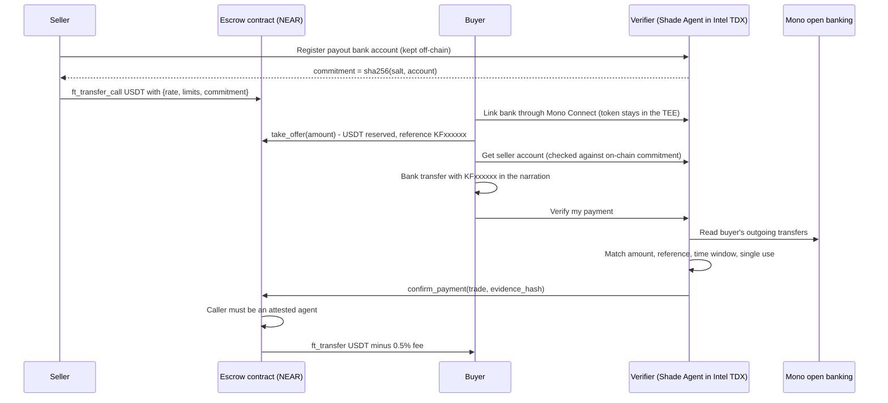

# Konfam

Peer-to-peer USDT for naira where **the bank transfer is verified by code running in a TEE, and the escrow on NEAR releases the moment the naira lands.**

Built for **NEAR HACKATHON (November 2026)**. Tracks: Real-World Money, Privacy and Private AI, AI Security and Defense.

> Demo video: _add your X post link here_
> Live app: _add your deployment URL here_

---

## The problem

Nigeria is the largest stablecoin market outside the United States, and most of that volume moves peer-to-peer: a seller has USDT, a buyer has naira in a bank account. Every one of those trades ends the same way: the buyer sends a bank transfer, then both sides wait while the seller "checks the alert".

That wait is where the money is lost:

- **Fake receipts.** Edited transfer screenshots are the most common P2P scam. Sellers release coins for money that never arrived.
- **Slow, manual release.** Buyers wait minutes to hours for a human to open a banking app and press release.
- **Disputes nobody can settle.** When the seller says "no alert", there is no neutral party who can see both bank accounts.

Centralised exchanges solved this by holding everyone's funds and running a support desk. Konfam solves it with a verifier nobody can tamper with.

## How it works



1. **Seller locks USDT.** The seller's bank details go to the verifier, never on-chain. Only a salted SHA-256 commitment is stored with the offer.
2. **Buyer reserves an amount.** The buyer attaches a 0.01 NEAR deposit, and the contract locks that USDT for a 30 minute payment window and issues a reference like `KF7Q2M9X`. The deposit comes back on release and is kept on cancellation, so nobody can tie up a seller's liquidity for free.
3. **Buyer pays from their linked bank.** The buyer sees the seller's account and can check, in the browser, that it hashes to the commitment the seller locked on-chain.
4. **The verifier confirms and the contract releases.** The Shade Agent reads the buyer's bank feed through Mono, finds a debit that matches amount, reference and time, records that the transfer was used, and calls `confirm_payment`. The contract only accepts that call from an agent whose TDX attestation matches the approved code measurements, and it can only pay the buyer of that trade.

If the buyer never pays, the seller reclaims the USDT after the window plus a grace period. If the payout transfer fails, anyone can retry it.

## What runs on NEAR

| NEAR feature | Where | What it does |
| --- | --- | --- |
| Shade Agent Framework 2.0 | `apps/agent/src/index.ts`, `contracts/escrow/src/agents.rs` | The verifier runs in an Intel TDX confidential VM on Phala Cloud. It registers with the contract using a dstack attestation, verified on-chain by `shade-attestation`. |
| Agent-gated contract method | `contracts/escrow/src/escrow.rs` `confirm_payment` | Only a registered agent with valid measurements, approved PPID and an unexpired attestation can mark a trade paid. |
| NEP-141 escrow | `ft_on_transfer`, `take_offer`, `withdraw_offer` | USDT is locked in the contract with `ft_transfer_call`, and payouts go out with `ft_transfer`. Callbacks re-credit on failure. |
| NEP-413 signed messages | `apps/agent/src/auth/nep413.ts` | Users sign one free message per session. The agent verifies the signature and checks on-chain that the key is a full-access key of the account. |
| NEAR Intents 1Click API | `apps/agent/src/routes/intents.ts`, `apps/web/src/routes/cash-out.tsx` | Buyers move their USDT to Tron, Solana, Base and other chains in one transaction. The agent proxies 1Click so the API key and app fee stay server-side. |
| Named accounts and wallets | `apps/web/src/lib/wallet.tsx` | NEAR Connect (`@hot-labs/near-connect`) for HOT, Meteor, MyNearWallet, Intear and more. |

## Try it in one minute

You need [Bun](https://bun.sh) 1.3 or newer. Rust is only needed for the contracts. `contracts/rust-toolchain.toml` pins Rust 1.86 with the wasm target, matching NEAR's reproducible build image, and rustup installs it on first use.

```bash
bun install
bun run demo
```

You should see the full trade run through the real verifier code, against an in-memory escrow and the sandbox bank:

```text
4. Buyer takes 100 USDT from the offer
   ✓ trade #1: pay ₦160,000.00 with reference KF....
7. Agent reads the bank feed inside the TEE and confirms on-chain
   ✓ amount: Amount matches the trade within tolerance
   ✓ reference: Narration contains KF....
   ✓ evidence hash 41afca53…  written to the contract
8. Escrow released USDT to the buyer
   ✓ status Released; buyer balance 99.5 USDT (fee 0.5 USDT)
9. Replay attempt: reuse the same transfer for a second trade
   ✗ rejected: reference, unused
```

Run every test:

```bash
bun run test
```

This runs 38 agent tests (`bun test`), then 26 contract tests (`cargo test` in `contracts/`). [VERIFY.md](VERIFY.md) maps each claim in this README to the command that proves it.

## Run the whole app

### Against the sandbox bank, without a NEAR contract

```bash
bun run dev:agent:memory
```

The agent starts on `http://localhost:3001` with an in-memory escrow and the sandbox bank. `GET /attestation` and the `/sandbox/*` endpoints work immediately.

### On NEAR testnet

Full steps are in [docs/testnet.md](docs/testnet.md). In short:

1. Build and deploy the test token from `contracts/test-token`. It has a `faucet` method so anyone can mint test USDT.
2. Put your token account into `deployment.yaml`, then run `shade deploy` with `environment: local`. This deploys and initialises the escrow.
3. Copy `.env.example` to `.env`, run `bun run dev:agent`, then whitelist the printed agent account with `shade whitelist`.
4. Copy `apps/web/.env.example` to `apps/web/.env`, then run `bun run dev:web` and open `http://localhost:5173`.

### In a real TEE

Set `environment: TEE` in `deployment.yaml`, set `build_docker_image.tag`, then run `shade deploy`. The CLI builds `apps/agent/Dockerfile`, pushes it, approves the image measurements in the contract and deploys to Phala Cloud. Point `VITE_AGENT_URL` at the URL it prints. The contract is initialised with `requires_tee: true`, so only that exact image can confirm payments.

## Configuration

Agent (`.env` at the repo root):

| Variable | Default | Meaning |
| --- | --- | --- |
| `NETWORK_ID` | `testnet` | `testnet` or `mainnet` |
| `CHAIN_MODE` | `near` | `near` for the real contract, `memory` for local demos |
| `AGENT_CONTRACT_ID` | | Escrow contract account |
| `SPONSOR_ACCOUNT_ID`, `SPONSOR_PRIVATE_KEY` | | Account that funds the agent's gas |
| `BANK_PROVIDER` | `sandbox` | `mono` for real bank accounts |
| `MONO_SECRET_KEY` | | Mono secret key, required with `mono` |
| `CORS_ORIGINS` | `*` | Comma-separated web origins |
| `OVERPAY_TOLERANCE_KOBO` | `10000` | Accept transfers up to ₦100 above the trade amount |
| `WATCH_INTERVAL_MS` | `20000` | First re-check delay for pending trades. It doubles after each miss, up to 5 minutes, to keep Mono calls down |
| `ONECLICK_JWT` | | Optional 1Click API key. Without one, 1Click charges its default fee |
| `ONECLICK_APP_FEE_BPS`, `ONECLICK_FEE_RECIPIENT` | `0` | Konfam's own fee on cash-outs, in basis points, paid to this NEAR account |

Web (`apps/web/.env`): `VITE_NETWORK_ID`, `VITE_CONTRACT_ID`, `VITE_AGENT_URL`, `VITE_RPC_URL`, `VITE_MONO_PUBLIC_KEY`.

## Open banking: Mono

Konfam reads bank data through [Mono](https://mono.co), the open banking provider that covers most Nigerian banks (acquired by Flutterwave in January 2026). The Central Bank of Nigeria approved the national open banking framework in August 2025.

- The buyer links an account with **Mono Connect** (`@mono.co/connect.js`) and logs in to their bank inside Mono's window.
- The verifier exchanges the code with `POST /v2/accounts/auth`, then reads `GET /v2/accounts/{id}/transactions` with the `mono-sec-key` header. Amounts come back in kobo.
- The Mono secret key and the account link exist only inside the TEE. `apps/agent/src/bank/mono.ts` is tested with recorded responses in `apps/agent/test/mono.test.ts`.

`apps/agent/src/bank/sandbox.ts` implements the same `BankProvider` interface with play money, so judges and screeners can run the full flow without a Nigerian bank account.

## Security model

**The contract guarantees:**

- USDT leaves escrow only to the seller (withdrawing unreserved funds or reclaiming an unpaid trade) or to the buyer of a confirmed trade.
- `confirm_payment` only works for a registered agent whose measurements, PPID and attestation expiry are still valid. Invalid agents are removed the first time they try.
- Storage can't be drained for free. Reserving needs a 0.01 NEAR deposit, offers must hold at least one full trade with a minimum of 1 USDT, and fully withdrawn offers are deleted.
- A trade can be confirmed once. A payout in flight can't be duplicated, because the `Releasing` state blocks `retry_payout`.
- Fees are capped at 2% in code.

**The verifier guarantees:**

- A bank transfer can settle only one trade. Each transaction id is stored with a unique constraint.
- It only accepts debits from the buyer's own linked account, for at least the trade amount and at most the tolerance above it, sent inside the payment window, with the trade reference in the narration. Banks that report only a date are matched on the trade's day in Lagos time.
- Only a salted hash of the evidence goes on-chain. Bank details, account numbers and narrations stay in the enclave.
- Seller payout details are shown only to the buyer of an open trade on that seller's offer, and the browser checks them against the on-chain commitment.

**What you still trust:** Intel TDX and Phala to keep the enclave sealed, the contract owner to approve only reviewed image measurements, and Mono to report bank data accurately. Not the seller, not the buyer, and not Konfam's servers: none of them can move escrowed USDT.

**Known limits:** a buyer could pay from a stolen bank account, which can get the seller's account frozen. The planned mitigation is matching the linked account holder's name against the buyer's KYC name, which Mono supports. Disputes are not arbitrated on-chain yet. Nothing here has been audited.

## Business model

- **0.5% fee on every released trade**, set in the contract and capped at 2%. At the scale of Nigerian P2P markets, even a small share of daily volume supports a team.
- **Cash-out fees.** Set `ONECLICK_APP_FEE_BPS` and the agent adds Konfam's fee to every cross-chain withdrawal quote.
- **Merchant API.** Exchanges, OTC desks and remittance apps need the same thing: "did this naira transfer really happen?" The verifier is a standalone service they can call.

## Repository layout

```text
apps/
  agent/            Shade Agent verifier: Hono on Bun, Mono and sandbox banks, NEP-413 auth
  web/              React Router app, shadcn components on Base UI, Tailwind v4
contracts/
  escrow/           Escrow and agent registry (Rust, near-sdk 5.26)
  test-token/       Testnet USDT with a faucet
packages/
  shared/           Types, money formatting, auth token format, payee commitment
scripts/demo.ts     Offline end-to-end demo
docs/testnet.md     Step-by-step testnet deployment
deployment.yaml     Shade CLI deployment
docker-compose.yaml Phala Cloud service definition
```

## Libraries and prior work

Everything in this repository was written during the hackathon. The agent registry and attestation flow in `contracts/escrow/src/agents.rs`, `owner.rs` and `events.rs`, plus the `deployment.yaml` layout, are adapted from NEAR's Apache-2.0 [Shade Agent template](https://github.com/NearDeFi/shade-agent-template). See [NOTICE](NOTICE).

Main libraries: `near-sdk`, `near-contract-standards`, `shade-attestation`, `@neardefi/shade-agent-js`, `hono`, `zod`, `@noble/curves`, `@noble/hashes`, `@scure/base`, `react`, `react-router`, `@base-ui/react`, `@tanstack/react-query`, `@hot-labs/near-connect`, `@mono.co/connect.js`, `tailwindcss`, `class-variance-authority`, `lucide-react`, `sonner`, and the Schibsted Grotesk and Martian Mono fonts from Fontsource.

## Roadmap

1. Name matching between the linked bank account and the buyer, to stop stolen-account payments.
2. Seller-side confirmation as a second signal for large trades.
3. Dispute flow with evidence shared through the verifier.
4. Mainnet launch with real USDT and a Mono production key.
5. Other markets with open banking: Ghana, Kenya and South Africa.

## License

Apache-2.0. See [LICENSE](LICENSE) and [NOTICE](NOTICE).
